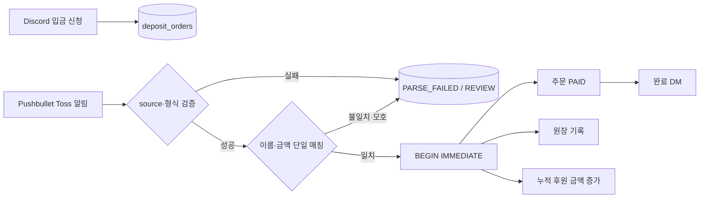

# yul-vending-machine

[](.github/workflows/ci.yml)
[](https://www.python.org/downloads/)
[](#지원-플랫폼)
[](#빠른-시작)
[](LICENSE)

Discord에서 받은 입금 신청과 Pushbullet의 Toss 알림을 대조해, 조건이 정확히 맞는 주문만 SQLite 원장과 사용자별 누적 후원 금액에 반영하는 봇입니다. Python 기준 구현과 Windows x64·Linux AArch64 native 구현을 함께 제공하며, 실제 장기 실행은 Linux AArch64 + systemd 프로파일을 기준으로 합니다.

> [!WARNING]
> 이 프로젝트는 실금융 알림과 Discord 사용자 정보를 다룰 수 있는 운영 도구입니다. 저장소의 fixture는 마스킹된 예시일 뿐이며, 토큰·계좌번호·실제 Push 원문·운영 데이터베이스를 커밋하거나 이슈·로그에 붙여 넣지 마세요. 운영 투입 전에는 소유자, 권한, 알림 형식, 백업·롤백 절차를 별도로 검토해야 합니다.

## 한눈에 보기

| 항목 | 내용 |
| --- | --- |
| 자동 반영 조건 | Toss source 검증 + 입금자명·금액이 유효한 주문 하나와 정확히 일치 |
| 저장소 | SQLite WAL, 외래 키, `BEGIN IMMEDIATE` 트랜잭션, 원장·누적 금액 |
| 외부 연동 | Discord Gateway/REST, Pushbullet WebSocket·polling |
| 기준 구현 | Python 3.11+ (`vending_machine/`) |
| native 경로 | Windows x64 개발·테스트, Linux AArch64 운영 프로파일 |
| 자동화 범위 | 주문 상태·원장·누적 금액·완료 DM만 처리하며 외부 송금은 하지 않음 |

## 주요 기능

- Discord 입금 패널, 버튼·모달 입력, 주문 생성, 완료 DM
- `/후원금액`, `/입금패널`, `/검토목록`, `/지급원장` 슬래시 명령
- Pushbullet WebSocket, `tickle`, `modified_after` polling 및 cursor 영속화
- Toss 앱·패키지·제목 필터, 입금자명·금액 파싱, UTF-8 정규화
- 동일 알림 재전송과 안정적인 ID가 없는 직접 미러 이벤트의 fingerprint 중복 방지
- 직접 미러 fingerprint는 lifecycle 메타데이터를 제외한 bounded payload 필드를 폭넓게 반영합니다.
- Windows x64와 Linux AArch64 native는 같은 바이트 payload에 같은 FNV-1a namespace를 사용하고, Python canonical SHA-256은 별도 namespace이므로 native와 Python의 push ID 문자열은 공유하지 않습니다. native fingerprint는 lifecycle 이외 필드의 원시 키 순서·공백·직렬화에 민감합니다.
- 생성·수정 시각이 모두 없는 direct mirror도 현재 수신 시각에 유효한 유일 주문과 이름·금액이 맞으면 자동 반영합니다. 실제 입금·알림 발생 시각은 확인하지 않으므로 오래된 이벤트가 새 주문에 반영될 위험을 운영자가 관리해야 합니다.
- 불일치·모호한 이벤트를 자동 반영하지 않고 `REVIEW` 상태로 보존
- SQLite 트랜잭션 안에서 주문 상태, 원장, 누적 금액, 이벤트 소비 상태를 함께 기록
- native 런타임의 설정 검증, Gateway·Push 재연결, graceful shutdown
- SHA-256 릴리스 매니페스트와 ELF·동적 의존성·systemd sandbox 검증

## 처리 흐름



길드 태그 관측을 켜면 Python과 Linux AArch64 경로가 `GUILD_MEMBER_UPDATE`와 멤버 목록을 이용해 변경 로그·현재 착용자 상태·선택적 역할 동기화를 별도로 수행합니다. 결제 트랜잭션과는 독립된 기능이며, 자세한 조건은 [Discord 길드 태그 관측](docs/discord-guild-tags.md)을 참고하세요.

## 지원 플랫폼

| 경로 | 용도 | 전제 조건 |
| --- | --- | --- |
| Python 3.11+ | 기준 동작, fixture 처리, 회귀 테스트 | Python만 필요하며 외부 패키지 없음 |
| Windows x64 native | 개발·테스트, native 경계 검증 | `build/build.ps1`로 빌드 |
| Linux AArch64 native | 실제 Gateway·Push 장기 실행, systemd 운영 | 대상 glibc·libcurl·OpenSSL·SQLite ABI 호환 |

길드 태그 관측은 Python과 Linux AArch64에서 제공하며 Windows x64 native에는 포함하지 않습니다. 이 기능을 사용할 경우 Discord Developer Portal에서 Server Members Intent를 활성화해야 합니다.

Windows x64 native는 만료 주문을 `PENDING`으로 유지하고 `expires_at` 조건으로 매칭에서 제외합니다. Linux AArch64와 Python의 `EXPIRED` 상태 전이와 정책이 다르므로 운영 DB를 Windows native와 교차 사용하지 마세요.

## 프로젝트 상태

- Python 기준 구현, fixture 처리, SQLite 결제 코어와 회귀 테스트가 저장소에 포함되어 있습니다.
- Windows x64 native는 개발·테스트용이며, Linux AArch64 native는 릴리스·운영 검증용입니다.
- 공개 CI는 Python 회귀와 Windows x64 native, Linux AArch64 native release 검증을 외부 서비스 없이 실행합니다. 실제 Discord·Pushbullet 통합, AArch64 장기 실행, 실입금 관찰은 별도 승인 환경에서 수행해야 합니다.
- 자동 반영은 항상 활성화되어 있고(`AUTO_CREDIT=1`), 외부 송금이나 환전 기능은 제공하지 않습니다.

## 빠른 시작

### 1. 저장소 준비

```powershell
git clone https://github.com/<owner>/<repo>.git
Set-Location yul-vending-machine
```

Python 3.11 이상을 사용합니다. Python 기준 구현은 런타임 의존성이 없으므로 바로 회귀 테스트를 실행할 수 있습니다.

```powershell
python -m unittest discover -s tests -v
```

### 2. 예시 설정으로 로컬 흐름 확인

`config.example.ini`는 비밀값과 운영 채널 ID를 비워 둔 공개 템플릿입니다. 로컬 CLI 확인에는 그대로 사용할 수 있고, 외부 서비스에 연결하려면 복사본에 자신의 값을 채워야 합니다.

```powershell
Copy-Item config.example.ini .local-vending.ini
python -m vending_machine --config config.example.ini init-db
python -m vending_machine --config config.example.ini create-order demo-user 홍길동 10
python -m vending_machine --config config.example.ini process-push fixtures/pushbullet/toss-mirror-direct-001.json
python -m vending_machine --config config.example.ini support-total demo-user
```

직접 미러 fixture는 `홍길동`·10원 예시이며 로컬 SQLite에만 기록됩니다. Discord나 Pushbullet에 연결하지 않으므로 공개 환경에서 안전하게 파서·매칭 흐름을 확인할 수 있습니다. 일반형 fixture는 호환성 회귀용이므로 운영 Toss 입력의 canonical 형식으로 간주하지 마세요.

### 3. native 빌드(선택)

전역 설치나 시스템 PATH 변경 없이 프로젝트 내부 `.tools/`에 빌드 도구를 준비할 수 있습니다.

```powershell
powershell -NoProfile -ExecutionPolicy Bypass -File build/bootstrap-tools.ps1
powershell -NoProfile -ExecutionPolicy Bypass -File build/bootstrap-aarch64-sysroot.ps1
```

필요한 경로만 빌드합니다.

```powershell
powershell -NoProfile -ExecutionPolicy Bypass -File build/build.ps1
powershell -NoProfile -ExecutionPolicy Bypass -File build/build-core.ps1
powershell -NoProfile -ExecutionPolicy Bypass -File build/build-aarch64.ps1
```

산출물은 `build/windows-x64/`와 `build/linux-aarch64/` 아래에 생성되며 Git에 추가하지 않습니다. Linux AArch64를 로컬에서 실행할 수 없다면 AArch64 호스트 또는 `qemu-aarch64`에서 native 검증을 수행하세요.

## 명령어

| 명령 | Python | Windows native | Linux AArch64 native | 설명 |
| --- | :---: | :---: | :---: | --- |
| `init-db` | ✓ | ✓ | ✓ | 스키마 적용과 멱등 migration |
| `create-order` | ✓ | ✓ | ✓ | Discord ID·입금자명·금액으로 주문 생성 |
| `process-push` | ✓ | ✓ | ✓ | JSON fixture 또는 이벤트 한 건 처리 |
| `review-list` | ✓ | ✓ | ✓ | 자동 처리되지 않은 이벤트 조회 |
| `ledger` | ✓ | ✓ | ✓ | 지급 원장 조회 |
| `support-total` | ✓ | ✓ | ✓ | 사용자별 누적 후원 금액 조회 |
| `panel-text` | ✓ | ✓ | ✓ | 패널 문구 확인 |
| `panel` | ✓ | 미지원 | 미지원 | Python 기준 구현에서 Discord 패널 게시 |
| `validate-config` | 미지원 | ✓ | ✓ | native 운영 설정 fail-closed 검증 |
| `gateway-probe` | 미지원 | 미지원 | ✓ | Linux Gateway TLS·Upgrade 단독 확인 |
| `run` | ✓ | ✓ | ✓ | Gateway·Push 수신 루프 실행 |

실제 장기 운영은 Linux AArch64 native의 `run`과 systemd 프로파일을 사용합니다. Python과 Windows native의 `run`은 개발·테스트 경로이며, 모든 native launcher는 Python 프로세스를 생성하지 않습니다.

```powershell
build\windows-x64\yul-vending-machine.exe --config .local-vending.ini validate-config
build\windows-x64\yul-vending-machine.exe --config .local-vending.ini review-list --limit 25
```

명령별 인자, 기본값, Python/native 차이는 [설정 가이드](docs/configuration.md)를 참고하세요.

## Toss 알림 계약

자동 반영은 다음 조건을 모두 만족하는 이벤트만 대상으로 합니다.

| 항목 | 운영 계약 |
| --- | --- |
| 애플리케이션 | `토스` |
| 패키지 | `viva.republica.toss` |
| 제목 | `10원 입금`과 같은 `^[0-9][0-9,]*원\s*입금$` |
| 본문 | `입금자명 → 내 토스뱅크 통장` |
| 시각 정보 | direct mirror는 `created`·`modified`가 없어도 허용하며 현재 수신 시각으로 주문 유효성을 확인 |

1원 알림처럼 Toss가 입금자명·금액을 검열한 이벤트, 출금·취소·잔액 변경, 다른 앱 알림, 이름·금액 불일치, 여러 주문과 겹치는 이벤트는 자동 반영하지 않습니다. 이런 이벤트는 파싱 실패 또는 검토 대상으로 남습니다. `created`와 `modified`가 모두 없는 direct mirror는 현재 수신 시각에 유효한 유일 주문과 일치하면 자동 반영되며 실제 발생 시각은 검증하지 않습니다.

## 설정과 비밀값

1. `config.example.ini`를 `.local-vending.ini` 또는 운영 전용 경로로 복사합니다.
2. `DISCORD_*`, `PUSHBULLET_ACCESS_TOKEN`, 은행 표시 정보와 금액 범위를 환경에 맞게 채웁니다.
3. 길드 태그를 사용할 경우 길드·로그·상태 채널·역할 ID, Server Members Intent, `Manage Roles` 권한과 역할 순서를 확인합니다.
4. `AUTO_CREDIT=1`을 유지합니다. 현재 구현에는 자동 반영을 끄는 모드가 없습니다.
5. 운영 설정은 저장소 밖에 두고 파일 권한을 운영 계정 전용으로 제한합니다.

Python은 환경 변수가 파일 값보다 우선하지만 native launcher는 설정 파일을 기준으로 읽습니다. 모든 키의 기본값·필수 여부·지원 범위는 [설정 가이드](docs/configuration.md)에 정리되어 있습니다. 토큰, 계좌번호, 실제 알림 원문, DB 파일은 커밋·릴리스 아카이브·CI artifact에 포함하지 마세요.

## 검증과 CI

로컬에서는 일반 회귀와 native 경계 회귀를 나누어 실행합니다.

```powershell
python -m unittest discover -s tests -v
python -m unittest tests.test_native_cli tests.test_native_core tests.test_native_protocol_contracts -v
```

`.github/workflows/ci.yml`은 Python 3.11·3.12·3.13 매트릭스와 Windows x64 native build/test, Linux AArch64 release/package·runtime gate를 실행합니다.

Linux gate는 Windows에서 cross-build한 release를 ARM64 runner에서 실행합니다. 따라서 `ubuntu-24.04-arm` 또는 동등한 AArch64 실행 환경과 `libcurl.so.4`·`libsqlite3.so.0` ABI가 필요합니다.

실제 Discord·Pushbullet 통합과 AArch64 장기 실행은 별도의 승인된 환경에서 제한된 자격 증명으로 검증해야 합니다. 테스트 결과에 토큰·응답 본문·Push 원문을 남기지 않습니다.

릴리스 전에는 [Native 전환 검증](docs/native-transition.md)의 ABI·ELF·checksum 게이트와 [운영 Runbook](docs/operations-runbook.md)의 백업·복원·롤백 절차를 따르세요. 공개 미러 또는 첫 릴리스 전에는 [GitHub 공개 배포 체크리스트](docs/public-release-checklist.md)도 완료해야 합니다.

## 저장소 구조

```text
vending_machine/       Python 기준 구현
src/                   Windows x64 / Linux AArch64 어셈블리
tests/                 단위·계약·native 회귀 테스트
fixtures/              마스킹된 Discord·Pushbullet fixture
db/                    SQLite schema와 migration
build/                 포터블 toolchain·native/release 빌드 스크립트
deploy/                systemd·설치·무결성·백업·복원·롤백 스크립트
docs/                  설계·설정·검증·운영 문서
```

## 문서 안내

| 문서 | 읽어야 할 때 |
| --- | --- |
| [설정 가이드](docs/configuration.md) | 설정 키, 기본값, Python/native 차이, 비밀값 취급 |
| [Discord 길드 태그 관측](docs/discord-guild-tags.md) | 태그 이벤트, 상태 임베드, 권한과 재연결 |
| [운영 Runbook](docs/operations-runbook.md) | 설치, 관측, 백업, 복원, 롤백 |
| [Native 전환 검증](docs/native-transition.md) | native 경계, AArch64 검증, 릴리스 게이트 |
| [설계·구현 문서](docs/vending-machine-plan.md) | 데이터 모델과 구현 결정의 상세 기록 |
| [기여 가이드](CONTRIBUTING.md) | 로컬 개발, fixture, 테스트, PR 기준 |
| [보안 정책](SECURITY.md) | 취약점 신고와 민감정보 처리 |

## 기여

재현 가능한 fixture와 회귀 테스트를 포함한 개선을 환영합니다. 변경 전 [기여 가이드](CONTRIBUTING.md)를 읽고, 실서비스 자격 증명·운영 DB·실제 Push 원문은 이슈나 PR에 첨부하지 마세요.

## 라이선스

이 프로젝트의 원본 코드는 [Apache License 2.0](LICENSE)(SPDX: `Apache-2.0`)으로 배포합니다. 재배포 시 `LICENSE` 전문을 포함하고, 수정한 파일에는 변경 사실을 표시해야 합니다. 외부 라이브러리·도구·콘텐츠에는 각각의 라이선스와 고지 의무가 적용될 수 있으므로 배포 전에 별도로 확인하세요.
